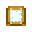

<!-- Improved compatibility of back to top link -->
<a id="readme-top"></a>

<!-- PROJECT SHIELDS -->
<div align="center">
  
  
  
  
</div>

<br />

<!-- HEADER BANNER (CENTERED) -->
<div align="center">
  
  <br />
  <p align="center">
    Official high-definition custom rank badges, font glyphs, and 3D cosmetic assets for <b>EvertaleMC Server</b>.
    <br />
    Compatible with both <b>Minecraft Java Edition</b> and <b>Minecraft Bedrock Edition</b> (Geyser / Floodgate).
  </p>
</div>

<!-- TABLE OF CONTENTS -->
<details>
  <summary><b>Table of Contents</b> (Click to expand)</summary>
  <ol>
    <li><a href="#about-the-resource-pack">About The Resource Pack</a></li>
    <li><a href="#server-rank-badges--glyphs">Server Rank Badges & Glyphs</a></li>
    <li><a href="#included-3d-cosmetics--models">Included 3D Cosmetics & Models</a></li>
    <li><a href="#crowns--diadems-cosmetics">Crowns & Diadems Cosmetics</a></li>
    <li><a href="#repository-structure">Repository Structure</a></li>
    <li><a href="#resource-pack-installation">Resource Pack Setup (Auto & Manual)</a></li>
    <li><a href="#staff-and-media-permissions">Rank Permissions (Admin & Media Setup)</a></li>
    <li><a href="#enforcing-resource-pack">Enforcing Resource Pack & /txt Command</a></li>
  </ol>
</details>

<br />

---

<!-- ABOUT SECTION (LEFT-ALIGNED) -->
<a id="about-the-resource-pack"></a>


**EVERTALE-RANK-COSMETICS** is the official server resource pack for **EvertaleMC**. It integrates seamlessly with **ItemsAdder** (Java) and **GeyserMC** (Bedrock), bringing customized pixel-art rank badges in chat/tablists and full 3D interactive cosmetics for players.

### Key Highlights
* **Pixel-Perfect Rank Badges**: Custom 80x16 RGBA textures rendered at crisp resolution across all client themes (Dark & Light modes).
* **Cross-Play Font Mapping**: Assigned private Unicode code points (`\uE800` to `\uE80E`) configured in `default.json` (Java) and patched directly into Bedrock `glyph_E8.png`.
* **Dynamic 3D Cosmetics**: Knight helms, wizard hats, animated wings, backpacks, and unique theme accessories.
* **Smart Version Overlays**: Built-in multi-version atlas overlays (`ia_overlay_*`) ensuring flawless display from Minecraft 1.20 up to 1.21.x+.

<p align="right">(<a href="#readme-top">back to top</a>)</p>

---

<!-- RANK BADGES SECTION (LEFT-ALIGNED) -->
<a id="server-rank-badges--glyphs"></a>


The table below showcases all active server rank badges, their visual in-game texture previews, and their corresponding Unicode font characters:

<table align="center" width="100%">
  <thead>
    <tr>
      <th align="center" width="22%">Rank Badge</th>
      <th align="center" width="18%">Rank Name</th>
      <th align="center" width="12%">Glyph</th>
      <th align="center" width="16%">Unicode Escape</th>
      <th align="left" width="32%">Role / Category</th>
    </tr>
  </thead>
  <tbody>
    <tr>
      <td align="center"></td>
      <td align="center"><b>Owner</b></td>
      <td align="center"><code></code></td>
      <td align="center"><code>\uE800</code></td>
      <td>Server Owner</td>
    </tr>
    <tr>
      <td align="center"></td>
      <td align="center"><b>Co-Owner</b></td>
      <td align="center"><code></code></td>
      <td align="center"><code>\uE801</code></td>
      <td>Server Co-Owner</td>
    </tr>
    <tr>
      <td align="center"></td>
      <td align="center"><b>Admin</b></td>
      <td align="center"><code></code></td>
      <td align="center"><code>\uE802</code></td>
      <td>Server Administrator</td>
    </tr>
    <tr>
      <td align="center"></td>
      <td align="center"><b>Helper</b></td>
      <td align="center"><code></code></td>
      <td align="center"><code>\uE803</code></td>
      <td>Staff Helper</td>
    </tr>
    <tr>
      <td align="center"></td>
      <td align="center"><b>Eclipsion</b></td>
      <td align="center"><code></code></td>
      <td align="center"><code>\uE804</code></td>
      <td>Premium Tier Rank</td>
    </tr>
    <tr>
      <td align="center"></td>
      <td align="center"><b>Moonveil</b></td>
      <td align="center"><code></code></td>
      <td align="center"><code>\uE805</code></td>
      <td>Premium Tier Rank</td>
    </tr>
    <tr>
      <td align="center"></td>
      <td align="center"><b>Selene</b></td>
      <td align="center"><code></code></td>
      <td align="center"><code>\uE806</code></td>
      <td>Premium Tier Rank</td>
    </tr>
    <tr>
      <td align="center"></td>
      <td align="center"><b>Lunaris</b></td>
      <td align="center"><code></code></td>
      <td align="center"><code>\uE807</code></td>
      <td>Premium Tier Rank</td>
    </tr>
    <tr>
      <td align="center"></td>
      <td align="center"><b>Crescent</b></td>
      <td align="center"><code></code></td>
      <td align="center"><code>\uE808</code></td>
      <td>Premium Tier Rank</td>
    </tr>
    <tr>
      <td align="center"></td>
      <td align="center"><b>Noctis</b></td>
      <td align="center"><code></code></td>
      <td align="center"><code>\uE809</code></td>
      <td>Premium Tier Rank</td>
    </tr>
    <tr>
      <td align="center"></td>
      <td align="center"><b>Everie</b></td>
      <td align="center"><code></code></td>
      <td align="center"><code>\uE80A</code></td>
      <td>Default Member Rank</td>
    </tr>
    <tr>
      <td align="center"></td>
      <td align="center"><b>Developer</b></td>
      <td align="center"><code></code></td>
      <td align="center"><code>\uE80B</code></td>
      <td>Server Developer</td>
    </tr>
    <tr>
      <td align="center"></td>
      <td align="center"><b>Media</b></td>
      <td align="center"><code></code></td>
      <td align="center"><code>\uE80C</code></td>
      <td>Content Creator / Media</td>
    </tr>
    <tr>
      <td align="center"></td>
      <td align="center"><b>Princess</b></td>
      <td align="center"><code></code></td>
      <td align="center"><code>\uE80D</code></td>
      <td>Special Custom Rank</td>
    </tr>
    <tr>
      <td align="center"></td>
      <td align="center"><b>MVP</b></td>
      <td align="center"><code></code></td>
      <td align="center"><code>\uE80E</code></td>
      <td>Special Custom Rank (Latest)</td>
    </tr>
  </tbody>
</table>

<p align="right">(<a href="#readme-top">back to top</a>)</p>

---

<!-- 3D COSMETICS SECTION (LEFT-ALIGNED) -->
<a id="included-3d-cosmetics--models"></a>


This repository contains full models, textures, animations, and JSON definitions:
* **Cosmetic Pack v1 & v2**: Wizard hats, knight helmets, custom backpacks, wizard hand items, and beetle armor pieces.
* **Dark Fantasy Cosmetics** (Vol. 1 & Vol. 4): Mythic armors and legendary accessory models.
* **HMCCosmetics & MoCosmetics**: Animated jetpacks, earth grabbers, and interactive wardrobe cosmetics.
* **Sniffer Cosmetics**: Themed seasonal models and textures.
* **Unicorn Cosmetics**: Animated unicorn horn accessories and particles.
* **Crowns & Diadems** (27 Types): Royal Crown, Renegade Crown, Sculk Crown, Skull Crown, Floral/Rose/Lavender/Dandelion/Wreath/Goldleaf/Autumn/Blackleaf Wreaths, Frost/Flame/Water/Thunder Circlets, Diamond/Emerald/Netherite/Lapis Coronets, Amethyst/Ruby/Ender/Crystal Diadems, Harper's Headset, Eversource Crown, and Diving Helmet with custom 3D models and emissive glow effects.
* **Custom UI & Fonts** (`_iainternal`): Enhanced custom server GUI menus, inventory layouts, and status icons.

<p align="right">(<a href="#readme-top">back to top</a>)</p>

---

---

<!-- CROWNS & DIADEMS SECTION (LEFT-ALIGNED) -->
<a id="crowns--diadems-cosmetics"></a>
<h3>Crowns & Diadems Cosmetics (27 Items)</h3>

Configured for **ItemsAdder**, **HMCCosmetics** (slot: HELMET), and **GeyserMC** (Bedrock Edition):

<table align="center" width="100%">
  <thead>
    <tr>
      <th align="center" width="10%">Icon</th>
      <th align="left" width="25%">Cosmetic Name</th>
      <th align="center" width="20%">ItemsAdder Item ID</th>
      <th align="center" width="15%">CustomModelData</th>
      <th align="left" width="30%">Permission Node</th>
    </tr>
  </thead>
  <tbody>
    <tr>
      <td align="center"></td>
      <td><b>Royal Crown</b></td>
      <td align="center"><code>crowns:royal_crown</code></td>
      <td align="center"><code>10090</code></td>
      <td><code>crowns.royal_crown</code></td>
    </tr>
    <tr>
      <td align="center"></td>
      <td><b>Renegade Crown</b></td>
      <td align="center"><code>crowns:renegade_crown</code></td>
      <td align="center"><code>10091</code></td>
      <td><code>crowns.renegade_crown</code></td>
    </tr>
    <tr>
      <td align="center"></td>
      <td><b>Sculk Crown</b></td>
      <td align="center"><code>crowns:sculk_crown</code></td>
      <td align="center"><code>10092</code></td>
      <td><code>crowns.sculk_crown</code></td>
    </tr>
    <tr>
      <td align="center"></td>
      <td><b>Skull Crown</b></td>
      <td align="center"><code>crowns:skull_crown</code></td>
      <td align="center"><code>10093</code></td>
      <td><code>crowns.skull_crown</code></td>
    </tr>
    <tr>
      <td align="center"></td>
      <td><b>Floral Crown</b></td>
      <td align="center"><code>crowns:floral_crown</code></td>
      <td align="center"><code>10094</code></td>
      <td><code>crowns.floral_crown</code></td>
    </tr>
    <tr>
      <td align="center"></td>
      <td><b>Rose Crown</b></td>
      <td align="center"><code>crowns:rose_crown</code></td>
      <td align="center"><code>10095</code></td>
      <td><code>crowns.rose_crown</code></td>
    </tr>
    <tr>
      <td align="center"></td>
      <td><b>Lavender Crown</b></td>
      <td align="center"><code>crowns:lavender_crown</code></td>
      <td align="center"><code>10096</code></td>
      <td><code>crowns.lavender_crown</code></td>
    </tr>
    <tr>
      <td align="center"></td>
      <td><b>Dandelion Crown</b></td>
      <td align="center"><code>crowns:dandelion_crown</code></td>
      <td align="center"><code>10097</code></td>
      <td><code>crowns.dandelion_crown</code></td>
    </tr>
    <tr>
      <td align="center"></td>
      <td><b>Wreath Crown</b></td>
      <td align="center"><code>crowns:wreath_crown</code></td>
      <td align="center"><code>10098</code></td>
      <td><code>crowns.wreath_crown</code></td>
    </tr>
    <tr>
      <td align="center"></td>
      <td><b>Goldleaf Wreath</b></td>
      <td align="center"><code>crowns:goldleaf_wreath</code></td>
      <td align="center"><code>10099</code></td>
      <td><code>crowns.goldleaf_wreath</code></td>
    </tr>
    <tr>
      <td align="center"></td>
      <td><b>Autumn Wreath</b></td>
      <td align="center"><code>crowns:autumn_wreath</code></td>
      <td align="center"><code>10100</code></td>
      <td><code>crowns.autumn_wreath</code></td>
    </tr>
    <tr>
      <td align="center"></td>
      <td><b>Blackleaf Wreath</b></td>
      <td align="center"><code>crowns:blackleaf_wreath</code></td>
      <td align="center"><code>10101</code></td>
      <td><code>crowns.blackleaf_wreath</code></td>
    </tr>
    <tr>
      <td align="center"></td>
      <td><b>Frost Circlet</b></td>
      <td align="center"><code>crowns:frost_circlet</code></td>
      <td align="center"><code>10102</code></td>
      <td><code>crowns.frost_circlet</code></td>
    </tr>
    <tr>
      <td align="center"></td>
      <td><b>Flame Circlet</b></td>
      <td align="center"><code>crowns:flame_circlet</code></td>
      <td align="center"><code>10103</code></td>
      <td><code>crowns.flame_circlet</code></td>
    </tr>
    <tr>
      <td align="center"></td>
      <td><b>Water Circlet</b></td>
      <td align="center"><code>crowns:water_circlet</code></td>
      <td align="center"><code>10104</code></td>
      <td><code>crowns.water_circlet</code></td>
    </tr>
    <tr>
      <td align="center"></td>
      <td><b>Thunder Circlet</b></td>
      <td align="center"><code>crowns:thunder_circlet</code></td>
      <td align="center"><code>10105</code></td>
      <td><code>crowns.thunder_circlet</code></td>
    </tr>
    <tr>
      <td align="center"></td>
      <td><b>Diamond Coronet</b></td>
      <td align="center"><code>crowns:diamond_coronet</code></td>
      <td align="center"><code>10106</code></td>
      <td><code>crowns.diamond_coronet</code></td>
    </tr>
    <tr>
      <td align="center"></td>
      <td><b>Emerald Coronet</b></td>
      <td align="center"><code>crowns:emerald_coronet</code></td>
      <td align="center"><code>10107</code></td>
      <td><code>crowns.emerald_coronet</code></td>
    </tr>
    <tr>
      <td align="center"></td>
      <td><b>Netherite Coronet</b></td>
      <td align="center"><code>crowns:netherite_coronet</code></td>
      <td align="center"><code>10108</code></td>
      <td><code>crowns.netherite_coronet</code></td>
    </tr>
    <tr>
      <td align="center"></td>
      <td><b>Lapis Lazuli Coronet</b></td>
      <td align="center"><code>crowns:lapis_lazuli_coronet</code></td>
      <td align="center"><code>10109</code></td>
      <td><code>crowns.lapis_lazuli_coronet</code></td>
    </tr>
    <tr>
      <td align="center"></td>
      <td><b>Amethyst Diadem</b></td>
      <td align="center"><code>crowns:amethyst_diadem</code></td>
      <td align="center"><code>10110</code></td>
      <td><code>crowns.amethyst_diadem</code></td>
    </tr>
    <tr>
      <td align="center"></td>
      <td><b>Ruby Diadem</b></td>
      <td align="center"><code>crowns:ruby_diadem</code></td>
      <td align="center"><code>10111</code></td>
      <td><code>crowns.ruby_diadem</code></td>
    </tr>
    <tr>
      <td align="center"></td>
      <td><b>Ender Diadem</b></td>
      <td align="center"><code>crowns:ender_diadem</code></td>
      <td align="center"><code>10112</code></td>
      <td><code>crowns.ender_diadem</code></td>
    </tr>
    <tr>
      <td align="center"></td>
      <td><b>Crystal Diadem</b></td>
      <td align="center"><code>crowns:crystal_diadem</code></td>
      <td align="center"><code>10113</code></td>
      <td><code>crowns.crystal_diadem</code></td>
    </tr>
    <tr>
      <td align="center"></td>
      <td><b>Harper's Headset</b></td>
      <td align="center"><code>crowns:harpers_headset</code></td>
      <td align="center"><code>10114</code></td>
      <td><code>crowns.harpers_headset</code></td>
    </tr>
    <tr>
      <td align="center"></td>
      <td><b>Eversource Crown</b></td>
      <td align="center"><code>crowns:eversource_crown</code></td>
      <td align="center"><code>10115</code></td>
      <td><code>crowns.eversource_crown</code></td>
    </tr>
    <tr>
      <td align="center"></td>
      <td><b>Diving Helmet</b></td>
      <td align="center"><code>crowns:diving_helmet</code></td>
      <td align="center"><code>10116</code></td>
      <td><code>crowns.diving_helmet</code></td>
    </tr>
  </tbody>
</table>

<p align="right">(<a href="#readme-top">back to top</a>)</p>

<!-- STRUCTURE SECTION (LEFT-ALIGNED) -->
<a id="repository-structure"></a>


```text
EVERTALE-RANK-COSMETICS/
├── assets/
│   ├── _iainternal/         # ItemsAdder internal GUI & core models
│   ├── cosmetic_packv1/     # Cosmetic Pack 1 textures & models
│   ├── cosmetic_packv2/     # Cosmetic Pack 2 textures & models
│   ├── hmccosmetics/        # HMC cosmetics models and animations
│   ├── minecraft/
│   │   ├── font/            # default.json (Rank font mappings)
│   │   ├── textures/ranks/  # 80x16 RGBA rank badge textures
│   │   └── models/          # Note block & custom model overrides
│   ├── sniffer/             # Sniffer themed cosmetics
│   └── unicorn_cosmetics/   # Unicorn themed cosmetics
├── ia_overlay_*/            # Multi-version client atlas overlays (1.20 - 1.21.x+)
├── pack.mcmeta              # Minecraft resource pack manifest
└── README.md                # Documentation & rank glyph mapping
```

<p align="right">(<a href="#readme-top">back to top</a>)</p>

---

<!-- HOW TO USE / INSTALLATION SECTION (LEFT-ALIGNED) -->
<a id="resource-pack-installation"></a>


### 1. Automatic Server Resource Pack (Recommended)

When configured on your server, players joining **EvertaleMC** receive an automatic prompt to download and apply the resource pack without needing to install anything manually.

#### Option A: Vanilla Server Configuration (`server.properties`)
Add or update the following lines in your server root `server.properties`:

```properties
resource-pack=https://github.com/NDERXZ/EVERTALE-RANK-COSMETICS/releases/download/v1.0.0/Evertale-Rank-Cosmetics-v1.0.0.zip
resource-pack-sha1=645eedc334f69c188afc9895ec36c781ac54ee90
require-resource-pack=true
resource-pack-prompt={"text":"Please accept the EvertaleMC resource pack to view server ranks and 3D cosmetics!","color":"gold"}
```

#### Option B: ItemsAdder Auto-Hosting (`plugins/ItemsAdder/config.yml`)
If using ItemsAdder to manage server packs, configure the `resource-pack.hosting` section:

```yaml
resource-pack:
  hosting:
    no-host:
      enabled: false
    auto-external-host:
      enabled: false
    self-host:
      enabled: false
    external-host:
      enabled: true
      url: "https://github.com/NDERXZ/EVERTALE-RANK-COSMETICS/releases/download/v1.0.0/Evertale-Rank-Cosmetics-v1.0.0.zip"
```

#### Option C: Bedrock Edition Players (GeyserMC)
* Bedrock players joining via **Geyser-Spigot / Floodgate** automatically receive all cosmetics and rank badges during the server handshake protocol. Custom mappings are registered in `plugins/Geyser/crowns_mappings.json`.

---

### 2. Manual Client Installation

Players who prefer to install the resource pack locally or offline can follow these steps:

#### Java Edition
1. Download **[Evertale-Rank-Cosmetics-v1.0.0.zip](https://github.com/NDERXZ/EVERTALE-RANK-COSMETICS/releases/download/v1.0.0/Evertale-Rank-Cosmetics-v1.0.0.zip)** from the latest release.
2. Open your Minecraft resource packs folder:
   * **Windows**: Press `Win + R`, type `%appdata%\.minecraft\resourcepacks\`, and press **Enter**.
   * **macOS**: `~/Library/Application Support/minecraft/resourcepacks/`
   * **Linux**: `~/.minecraft/resourcepacks/`
3. Copy `Evertale-Rank-Cosmetics-v1.0.0.zip` into the folder.
4. In Minecraft, navigate to **Options** -> **Resource Packs...** -> Move **Evertale-Rank-Cosmetics-v1.0.0** to the right column (**Selected**) -> Click **Done**.

#### Bedrock Edition
* Download the Bedrock pack package from the release or join the server directly to receive the pack automatically.

<p align="right">(<a href="#readme-top">back to top</a>)</p>

---

<!-- STAFF & MEDIA PERMISSIONS SECTION (LEFT-ALIGNED) -->
<a id="staff-and-media-permissions"></a>
<h3>Rank Permissions (Admin & Media Setup)</h3>

To ensure **Admin** and **Media** ranks have full access to wear all 27 crowns, hats, wings, backpacks, and exclusive server cosmetics, grant the following wildcard permissions in **LuckPerms**:

#### 1. Granting Permissions to Admin Rank
Run these commands in your server console:

```text
/lp group admin permission set hmccosmetics.* true
/lp group admin permission set crowns.* true
/lp group admin permission set cosmetic_packv1.* true
/lp group admin permission set cosmetic_packv2.* true
/lp group admin permission set dark_fantasy_cosmetics.* true
/lp group admin permission set mocosmetics.* true
/lp group admin permission set sniffer.cosmetics true
/lp group admin permission set unicorn_cosmetics.* true
/lp group admin permission set ia.user.image.* true
/lp group admin permission set ia.menu.* true
```

#### 2. Granting Permissions to Media Rank
Run these commands in your server console:

```text
/lp group media permission set hmccosmetics.* true
/lp group media permission set crowns.* true
/lp group media permission set cosmetic_packv1.* true
/lp group media permission set cosmetic_packv2.* true
/lp group media permission set dark_fantasy_cosmetics.* true
/lp group media permission set mocosmetics.* true
/lp group media permission set sniffer.cosmetics true
/lp group media permission set unicorn_cosmetics.* true
/lp group media permission set ia.user.image.* true
/lp group media permission set ia.menu.* true
```

> [!NOTE]
> All permission command scripts and files are also saved in [`plugins/LuckPerms/commands.txt`](plugins/LuckPerms/commands.txt).

<p align="right">(<a href="#readme-top">back to top</a>)</p>

---

<!-- ENFORCING PACK & /TXT SECTION (LEFT-ALIGNED) -->
<a id="enforcing-resource-pack"></a>
<h3>Enforcing Resource Pack & /txt Command Setup</h3>

#### 1. Enforce Resource Pack For All Connecting Players
To ensure **all players** are required to use the resource pack upon joining (preventing missing textures or bypassed packs), set `require-resource-pack=true` in `server.properties`:

```properties
resource-pack=https://github.com/NDERXZ/EVERTALE-RANK-COSMETICS/releases/download/v1.0.0/Evertale-Rank-Cosmetics-v1.0.0.zip
resource-pack-sha1=645eedc334f69c188afc9895ec36c781ac54ee90
require-resource-pack=true
resource-pack-prompt={"text":"Kamu wajib menggunakan Resource Pack resmi EvertaleMC untuk melihat rank badges dan 3D cosmetics!","color":"gold"}
```

#### 2. Push Update Live to All Currently Online Players
To send the new resource pack to players who are already in-game without restarting the server, execute in console:
```text
# If using ItemsAdder:
/iaapply @a

# Or via vanilla command:
/minecraft:sendresourcepack @a https://github.com/NDERXZ/EVERTALE-RANK-COSMETICS/releases/download/v1.0.0/Evertale-Rank-Cosmetics-v1.0.0.zip 645eedc334f69c188afc9895ec36c781ac54ee90 true
```

#### 3. Setting Up the `/txt` In-Game Command
Players can type `/txt` or `/texturepack` at any time to re-download or refresh their pack if it glitched or unloaded:

* **Native Bukkit / Paper (`commands.yml`)**:
  Add to your server root `commands.yml` (file: [`server_configs/commands.yml.snippet`](server_configs/commands.yml.snippet)):
  ```yaml
  aliases:
    txt:
      - "iaapply $$1"
    texturepack:
      - "txt"
    pack:
      - "txt"
  ```

* **DeluxeMenus GUI (`plugins/DeluxeMenus/`)**:
  Interactive GUI menu available at [`plugins/DeluxeMenus/gui_menus/texturepack.yml`](plugins/DeluxeMenus/gui_menus/texturepack.yml) featuring 1-click automatic apply or manual zip download link.

* **MyCommand (`plugins/MyCommand/`)**:
  Custom command configuration available at [`plugins/MyCommand/commands/txt.yml`](plugins/MyCommand/commands/txt.yml).

<p align="right">(<a href="#readme-top">back to top</a>)</p>
